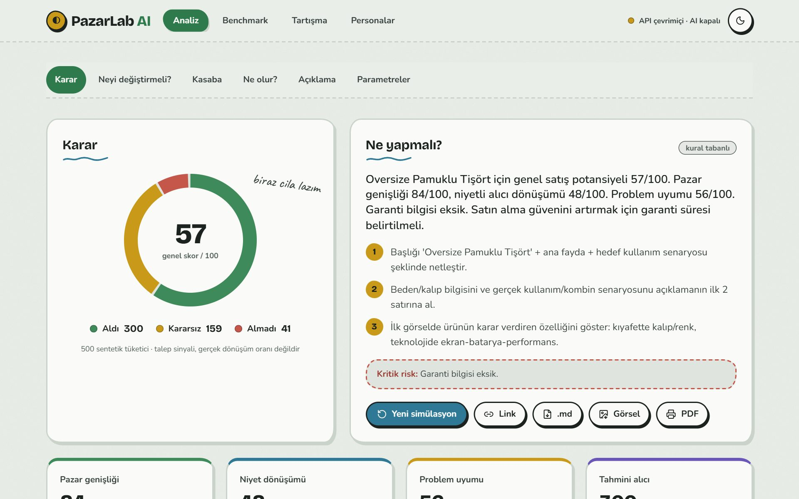
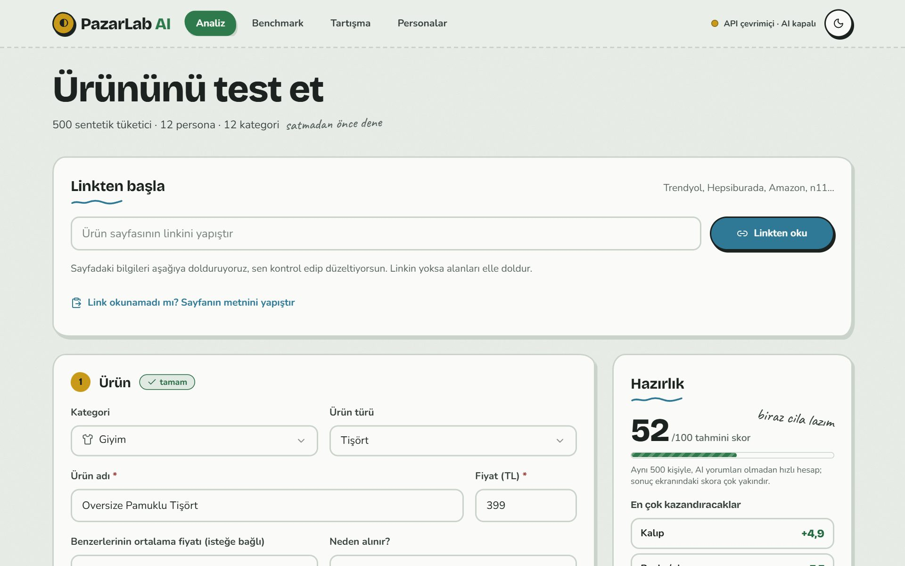
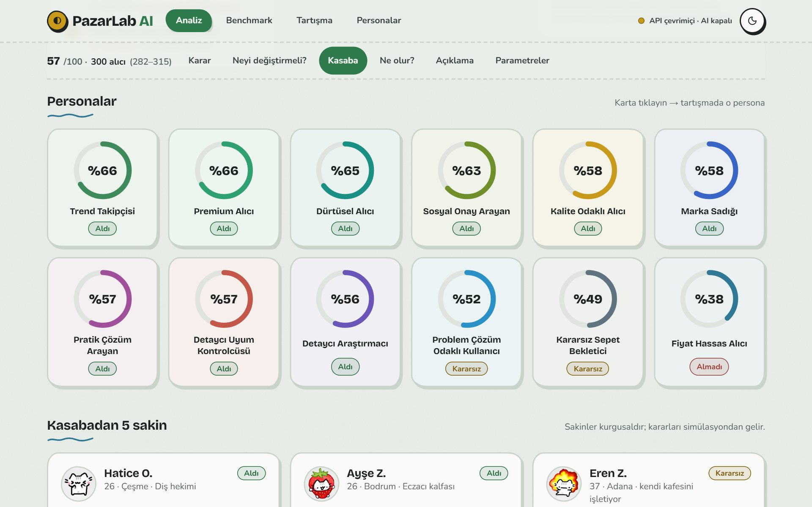
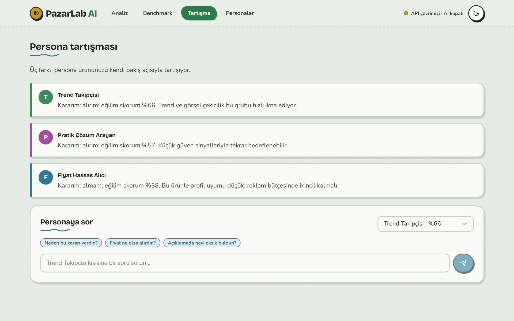
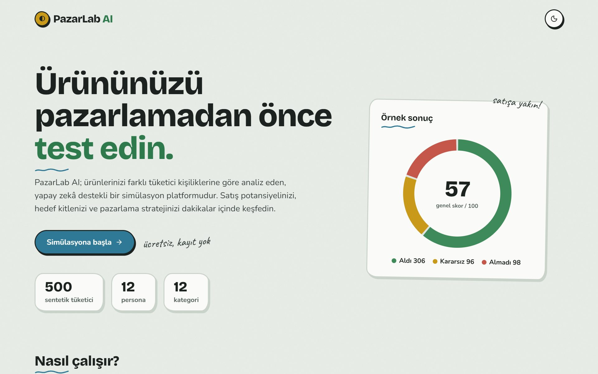
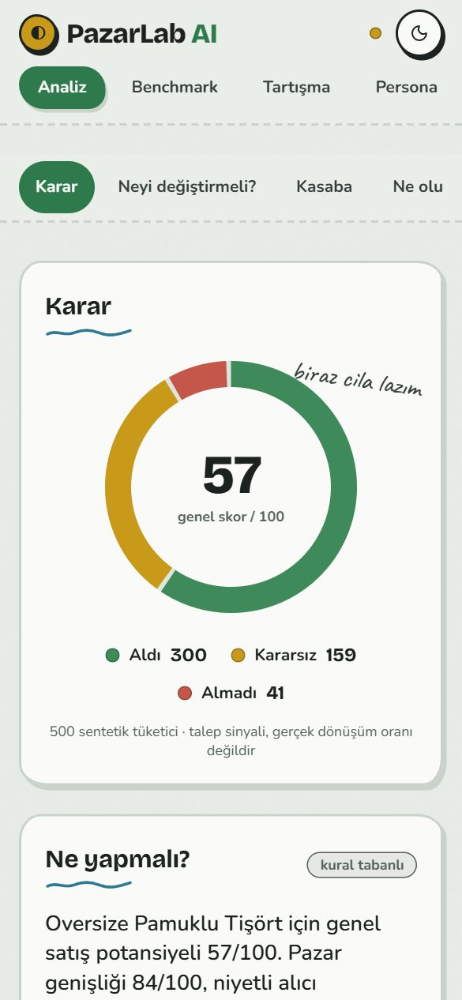
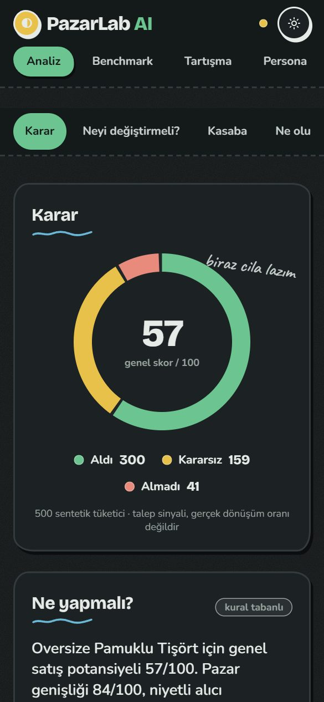
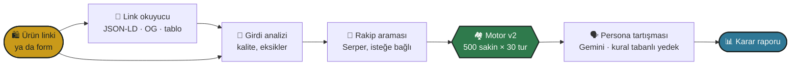
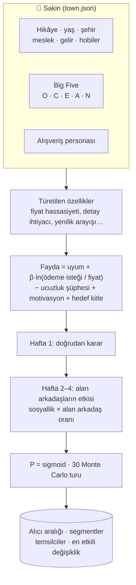

<div align="center">



<br>

[](https://github.com/Serdarsahinn05/btk26-pazarlab-ai/actions/workflows/ci.yml)


<br>


**500 sentetik sakinden oluşan bir kasaba, ürününü senden önce görür.**<br>
Kim alır, kim kararsız kalır, kim neden vazgeçer? Ve neyi değiştirirsen kaç kişi daha alır?

[Ne yapar](#-ne-yapar) · [Ekranlar](#-ekranlar) · [Nasıl çalışır](#-nasıl-çalışır) · [Hızlı başlangıç](#-hızlı-başlangıç) · [API](#-api) · [Dokümanlar](#-dokümanlar)

</div>

---

## ✨ Ne yapar

Satıcı ürününün linkini yapıştırır ya da formu doldurur. PazarLab ürünü 500 kişilik kurgusal bir kasabada dener. Her sakinin bir hikâyesi, Big Five kişiliği, geliri, arkadaşları ve "en fazla şu kadar veririm" dediği bir fiyatı var. Sonuç tek bir skor değil; gerekçeleriyle bir karar raporu.

<table>
<tr>
<td width="33%" valign="top">

### 🏘️ Yaşayan kasaba
500 sakin, 12 alışveriş personası, Big Five kişilik. Her sakinin **ödeme isteği** ayrı; alanlar arkadaşlarına anlatır ve ürün **ağızdan ağıza** 4 haftada yayılır. 30 Monte Carlo turu, sonuç aralıkla: `300 alıcı (282–315)`.

</td>
<td width="33%" valign="top">

### 🎯 Ne değiştirmeli?
Aynı kasabada kargo, iade, garanti ve ±%10 fiyat tek tek denenir. **En etkili 3 değişiklik** alıcı ve ciro farkıyla gelir. Form doldurulurken bile canlı **Hazırlık** paneli hangi alanın kaç puan getireceğini söyler.

</td>
<td width="33%" valign="top">

### 🔗 Linkten okur
JSON-LD, Open Graph, microdata, özellik tabloları ve sayfa içi JSON'dan ad, fiyat, görsel, kategori, **mağaza puanı** ve değerlendirme sayısı. Link okunamazsa sayfanın metnini yapıştırmak yeter.

</td>
</tr>
<tr>
<td valign="top">

### 💬 Personaya sor
Personalar ürünü tartışır, sonra istediğine soru sorarsın: "Fiyat ne olsa alırdın?" Cevap canlı akar. AI kotası dolarsa persona kendi simülasyon verisinden **kural tabanlı** cevap verir.

</td>
<td valign="top">

### 📈 Ne olur?
**Fiyat eğrisi** (fiyatın %60–140'ı, 9 nokta, en çok ciro ve en çok alıcı noktası), **A/B karşılaştırma**, yeniden yazılan açıklamayı aynı 500 kişide deneme, **rakip fiyat kartı**.

</td>
<td valign="top">

### 🔌 Claude connector
Yerleşik **MCP sunucusu**: 7 araç (`simulate_product`, `price_sweep`, `compare_variants`…). PazarLab'ı kendi Claude'una ekle; yorumları senin aboneliğin yazar, sunucu AI çağırmaz.

</td>
</tr>
</table>

> [!NOTE]
> Simülasyon motoru **AI kullanmaz**: deterministik, ~170 ms ve ücretsiz. Gemini yalnızca yorum, tartışma ve girdi analizi yazar. Anahtar yoksa ya da kota dolarsa her şey kural tabanlı metinlerle çalışmaya devam eder.

---

## 🖼️ Ekranlar

<div align="center">

<picture>
  <source media="(prefers-color-scheme: dark)" srcset="docs/assets/result-dark.jpg">
  
</picture>
<sub><b>Karar</b>: 500 kişinin dağılımı, el yazısı not, ilk 3 aksiyon ve kritik risk.</sub>

</div>

<table>
<tr>
<td width="50%">
<picture>
  <source media="(prefers-color-scheme: dark)" srcset="docs/assets/form-dark.jpg">
  
</picture>
<p align="center"><sub><b>Ürün ekleme</b>: linkten başla, canlı Hazırlık paneli</sub></p>
</td>
<td width="50%">
<picture>
  <source media="(prefers-color-scheme: dark)" srcset="docs/assets/town-dark.jpg">
  
</picture>
<p align="center"><sub><b>Kasaba</b>: 12 persona ve hikâyeli sakinler</sub></p>
</td>
</tr>
<tr>
<td width="50%">
<picture>
  <source media="(prefers-color-scheme: dark)" srcset="docs/assets/debate-dark.jpg">
  
</picture>
<p align="center"><sub><b>Tartışma</b>: personalar konuşur, sen sorarsın</sub></p>
</td>
<td width="50%">
<picture>
  <source media="(prefers-color-scheme: dark)" srcset="docs/assets/landing-dark.jpg">
  
</picture>
<p align="center"><sub><b>Açılış</b>: "Canlı pazar yeri" tasarımı, açık ve koyu tema</sub></p>
</td>
</tr>
</table>

<details>
<summary>📱 Mobil görünüm</summary>
<br>
<p align="center">
  
  &nbsp;&nbsp;
  
</p>
</details>

---

## 🧠 Nasıl çalışır



Her adım bittiğinde arayüze **SSE** ile haber verilir; ilerleme çubuğu tahmin değil, gerçek adımdır.

<details>
<summary><b>🔬 Motorun içi: bir sakin nasıl karar verir?</b></summary>
<br>



- **Ödeme isteği:** kategori ortalaması × gelir × fiyat hassasiyeti × ürün kalitesi × sakine özel log-normal sapma. Fiyat düştükçe alıcı artar; "çok ucuz şüphesi" yalnızca kalite odaklı sakinlerde.
- **Açıklanabilir:** her kararın bileşenleri kaydedilir. *"Almadı: fiyatı pahalı buluyor (en fazla 149 TL verirdi)."*
- **Klişe önlemi:** cinsiyet personadan, meslekten ve hobilerden bağımsız. Sakinler kurgusaldır ve arayüzde öyle yazar.
- Bütün sabitler [`engine.py`](backend/app/services/engine.py)'de belgelenmiş varsayımlardır.

</details>

### 🧩 Yığın

| Katman | Teknoloji | Görev |
|---|---|---|
| 🎨 Frontend | Next.js 16 · React 19 · Tailwind 4 | Form, sonuç raporu, grafikler (saf SVG), tartışma, sohbet |
| ⚙️ API | FastAPI · Pydantic | Uç noktalar, SSE akışları, rate limit, SSRF korumalı HTTP |
| 🏘️ Motor | Python (stdlib) | Kasaba, ödeme isteği, yayılma, Monte Carlo, iyileştirmeler |
| 🤖 AI | Gemini (önbellekli, IP başına günlük kota) | Yorumlar, tartışma, girdi ve görsel analizi |
| 🔌 MCP | `mcp` 2.3 | Claude connector, 7 araç |
| 💾 Kayıt | SQLite (stdlib) | Paylaşılabilir sonuç linkleri, 90 gün |
| 🧪 Test | pytest · Playwright · GitHub Actions | 278 backend testi, tarayıcı testleri, `pip-audit`, `npm audit` |

---

## 🚀 Hızlı başlangıç

### 🐳 Docker ile (önerilen)

```powershell
git clone https://github.com/Serdarsahinn05/btk26-pazarlab-ai.git
cd btk26-pazarlab-ai
Copy-Item backend\.env.example backend\.env   # GEMINI_API_KEY isteğe bağlı
docker compose up --build
```

| | Adres |
|---|---|
| 🌐 Site | <http://localhost:3000> |
| ❤️ API sağlığı | <http://localhost:8000/api/health> |

İki imaj da root olmayan kullanıcıyla çalışır (`app`, `node`); backend'de `HEALTHCHECK` var.

### 🛠️ Yerel geliştirme

<details>
<summary>Backend (Python 3.11–3.13)</summary>

```powershell
cd backend
py -3.13 -m venv venv
venv\Scripts\pip install -r requirements-dev.txt
venv\Scripts\python -m uvicorn app.main:app --port 8000
venv\Scripts\python -m pytest          # 278 test
venv\Scripts\python -m ruff check .
```

</details>

<details>
<summary>Frontend (Node 20+)</summary>

```powershell
cd frontend
npm install
npm run dev                  # http://localhost:3000
npm run lint; npx tsc --noEmit
$env:PYTHON="..\backend\venv\Scripts\python"; npm run test:e2e   # Playwright
```

</details>

### 🔑 Ortam değişkenleri

| Değişken | Gerekli mi | Ne işe yarar |
|---|:---:|---|
| `GEMINI_API_KEY` | – | AI yorumları ve tartışma. Yoksa kural tabanlı metinler. |
| `SERPER_API_KEY` | – | Rakip araması ve fiyat kartı. Yoksa bu adım atlanır. |
| `GEMINI_MODEL` | – | Modeli sabitle; boşsa en uygun kararlı model seçilir. |
| `CORS_ALLOWED_ORIGINS` | ✔️ (yayında) | Sitenin adresi. |
| `AI_DAILY_CALLS_PER_IP` | – | IP başına günlük AI çağrısı (varsayılan 60). |
| `NEXT_PUBLIC_API_URL` | ✔️ (yayında) | Frontend'in API adresi; build sırasında gömülür. |

Tam liste: [`backend/.env.example`](backend/.env.example). Yayına alma: [docs/deployment.md](docs/deployment.md).

---

## 📡 API

| Yöntem | Yol | Ne yapar | AI |
|---|---|---|:---:|
| `POST` | `/api/simulate` | Tam simülasyon + rapor, kaydeder | ✨ |
| `POST` | `/api/simulate/stream` | Aynısı, adım adım SSE | ✨ |
| `GET` | `/api/simulations/{id}` | Paylaşılan sonucu getirir | – |
| `POST` | `/api/draft-check` | Yarım taslak için tahmini skor ve alan kazançları | – |
| `POST` | `/api/price-sweep` | 9 noktalı fiyat eğrisi | – |
| `POST` | `/api/compare` | A/B karşılaştırma | – |
| `POST` | `/api/read-product-link` | Linkten ürün bilgisi | ✨ |
| `POST` | `/api/read-product-page` | Sayfa HTML'i ya da kopyalanmış metinden okuma | ✨ |
| `POST` | `/api/analyze-input` | Girdi kalitesi kontrolü | ✨ |
| `POST` | `/api/analyze-images` | Ürün görsellerinin değerlendirmesi | ✨ |
| `POST` | `/api/persona-chat` | Personaya soru, SSE | ✨ |
| `GET` | `/api/health` | API, model, kota ve önbellek durumu | – |
| `POST` | `/mcp` | MCP sunucusu (Claude connector) | – |

✨ = AI varsa kullanır, yoksa kural tabanlı çalışır. Sözleşme: [docs/api-contract.md](docs/api-contract.md).

---

## 🛡️ Güvenlik

- **SSRF:** link okuyucu IP sabitleme, port kısıtı ve elle izlenen yönlendirmelerle yalnızca herkese açık adreslere gider.
- **Prompt injection:** kullanıcı verisi system talimatından ayrı, `<data>` bloğu içinde ve kırpılmış gider.
- **Kötüye kullanım:** uç nokta başına rate limit, IP başına günlük AI kotası, gövde boyutu sınırı, CORS allowlist.
- **Gizlilik:** hesap yok; sonuçlar yalnızca linki bilen tarafından açılır, görseller kaydedilmez.

Ayrıntılar: [docs/SECURITY_AUDIT.md](docs/SECURITY_AUDIT.md).

---

## 🗺️ Yol haritası

```text
✅ Güvenlik · çekirdek hatalar · "Canlı pazar yeri" tasarımı · geçmiş ve paylaşım
✅ Fiyat eğrisi · A/B · canlı ilerleme · persona sohbeti · CI · Next 16 · Tailwind 4
✅ AI bütçesi · AI'sız sohbet · MCP connector · Motor v2 + kasaba · 12 kategori ailesi
✅ Ürün ekleme v2 · link okuma v2 · sonuç yerleşimi · içgörü özellikleri · temizlik + e2e
⬜ Tarayıcı eklentisi · kendi nüfusunu yükle (KVKK) · çoklu LLM · Claude içinde PazarLab
```

Fazlar, kabul kriterleri ve her adımın doğrulaması: [docs/ROADMAP.md](docs/ROADMAP.md).

---

## 📚 Dokümanlar

| | Doküman | İçerik |
|:---:|---|---|
| 🎨 | [DESIGN.md](DESIGN.md) | Renk token'ları, tipografi, bileşen kalıpları |
| 🗺️ | [ROADMAP.md](docs/ROADMAP.md) | Fazlar, durum, sıradaki iş |
| 🛡️ | [SECURITY_AUDIT.md](docs/SECURITY_AUDIT.md) | Bulgular ve düzeltmeler |
| 🔧 | [IMPROVEMENTS.md](docs/IMPROVEMENTS.md) | Hatalar, teknik borç, özellik fikirleri |
| 📡 | [api-contract.md](docs/api-contract.md) | HTTP sözleşmesi |
| 🚢 | [deployment.md](docs/deployment.md) | nginx, SSE, Vercel + Render |
| 🔌 | [mcp-connector.md](docs/mcp-connector.md) | PazarLab'ı Claude'a ekleme |
| 🏗️ | [architecture.md](docs/architecture.md) | Sistem akışı |
| 🎬 | [demo-script.md](docs/demo-script.md) | Sunum akışı |

---

<div align="center">

**PazarLab AI** · satmadan önce kasabaya sor. 🏘️

<sub>Sonuçlar 500 kurgusal sakinden gelen bir <b>talep sinyalidir</b>, gerçek dönüşüm oranı değildir.</sub>

</div>
